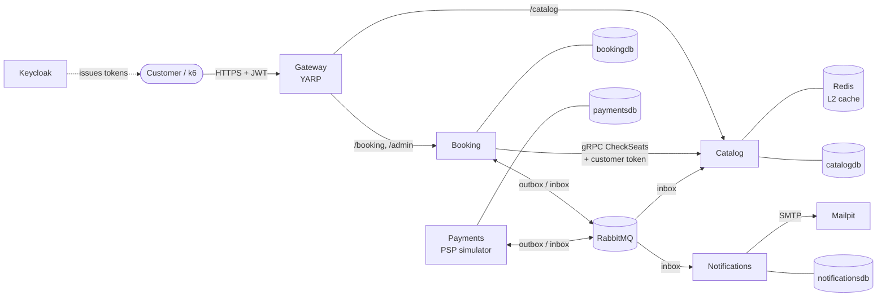
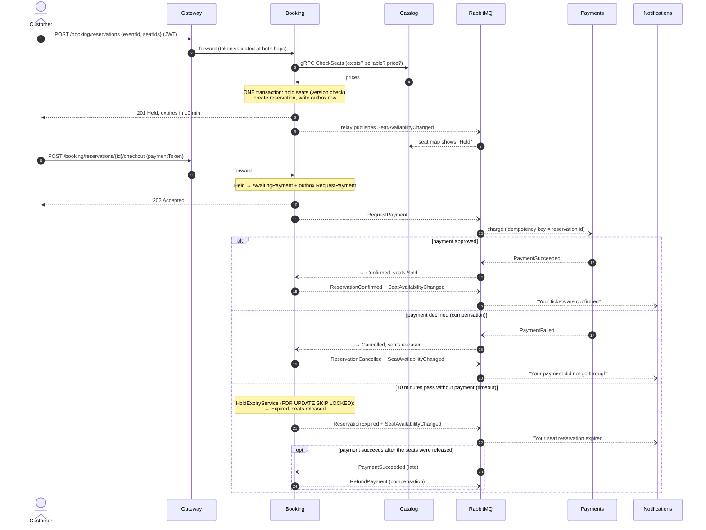
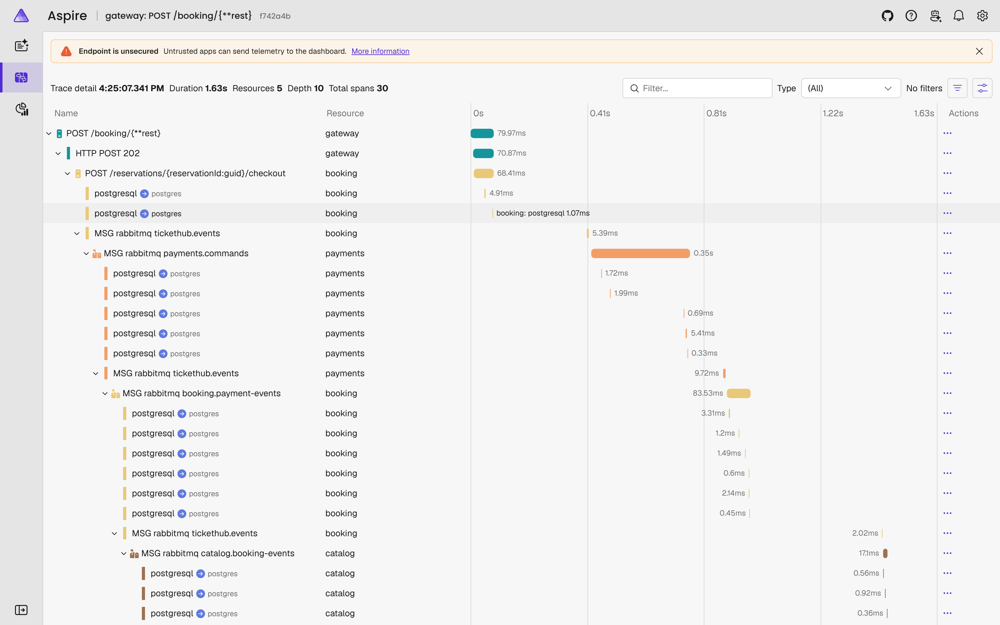

# TicketHub

An event ticketing platform built as .NET 10 microservices with an event-driven checkout. Its central claim is simple and tested: **the same seat is never sold twice**, even when 500 people try to buy it in the same instant.

[](https://github.com/lu1spere1ra/TicketHub/actions/workflows/build.yml)
[](https://github.com/lu1spere1ra/TicketHub/actions/workflows/e2e.yml)
[](https://github.com/lu1spere1ra/TicketHub/actions/workflows/docker.yml)

**What it demonstrates.** Each item links to the ADR that explains and defends it:

- **[Transactional outbox and idempotent consumers](docs/adr/0003-transactional-outbox-and-idempotent-consumers.md):**
  - Hand-written on RabbitMQ.Client, with no messaging framework ([why](docs/adr/0002-messaging-with-rabbitmq-client.md)).
  - Retries and a dead-letter queue ([ADR-0007](docs/adr/0007-retry-and-dead-letter-topology.md)).
- **[An orchestrated saga](docs/adr/0006-checkout-saga-orchestration.md):** reserve → pay → confirm, with compensations (released seats, refunds) and a 10-minute hold expiry.
- **[Overbooking prevention](docs/adr/0004-preventing-overbooking.md):** optimistic concurrency on a per-seat version, proved with k6 and a database audit.
- **[A synchronous gRPC check plus an asynchronous projection](docs/adr/0005-seat-availability-sync-check-async-projection.md),** with **[resilience that actually works for gRPC](docs/adr/0008-resilience-policies.md).**
- **[Caching that needs no invalidation](docs/adr/0009-catalog-caching.md):** static data in HybridCache with Redis, live data always read fresh.
- **[One trace per purchase](docs/adr/0011-distributed-tracing-through-outbox.md),** across HTTP, gRPC, the outbox and RabbitMQ.
- **[Keycloak OIDC](docs/adr/0010-authentication-with-keycloak.md):** JWT validated at the gateway *and* in every service.

## Architecture



| Service | Owns | Talks to |
|---|---|---|
| **Gateway** | Routing and edge authorisation | Catalog, Booking (HTTP) |
| **Catalog** | Venues, seats, events, prices; a read-only projection of seat status | Redis; consumes `SeatAvailabilityChanged` |
| **Booking** | **Who holds which seat**, reservations (the saga state), dead-letter archive | Catalog (gRPC); publishes and consumes messages |
| **Payments** | Payments; a simulated PSP with configurable latency, declines and outages | Messages only |
| **Notifications** | Nothing but its inbox | Messages, SMTP |

The key design call is where "availability" lives. **Catalog** says whether a seat *can* be sold and at what price. **Booking** says whether it is *free right now*, because the seat claim and the reservation must commit in one ACID transaction. The seat map is a projection of Booking's events, so it is eventually consistent; the authoritative check happens at hold time ([ADR-0001](docs/adr/0001-service-boundaries-and-data-ownership.md)).

## The booking flow



## Running it

You need the .NET 10 SDK and Docker. All host ports are in **5200–5299**. Aspire uses 5200–5249 and docker-compose uses 5250–5299, so both can run side by side.

### With Aspire (recommended for development)

```bash
dotnet run --project src/TicketHub.AppHost
```

The dashboard is at <http://localhost:5201> and shows resources, logs, traces and metrics.

### With docker-compose

```bash
docker compose -f deploy/docker-compose.yml up --build -d
```

```bash
scripts/compose-smoke.sh
```

`compose-smoke.sh` logs in, holds a seat, pays, and checks the email.

| | Aspire | Compose |
|---|---|---|
| Gateway (the API) | <http://localhost:5200> | <http://localhost:5250> |
| Aspire dashboard (traces, metrics) | <http://localhost:5201> | <http://localhost:5251> |
| Keycloak (admin / admin) | <http://localhost:5220> | <http://localhost:5260> |
| Mailpit (emails) | <http://localhost:5221> | <http://localhost:5261> |
| RabbitMQ management (guest / guest) | <http://localhost:5222> | <http://localhost:5262> |
| PostgreSQL / Redis | 5224 / 5225 | 5264 / 5265 |

**Users:** `alice` and `bob` (customers) and `ops` (admin). The password for all of them is `password`. Every newly registered user becomes a customer.

### Trying the API

Get a token:

```bash
TOKEN=$(curl -s localhost:5260/realms/tickethub/protocol/openid-connect/token \
  -d grant_type=password -d client_id=tickethub-cli -d username=alice -d password=password | jq -r .access_token)
```

These examples use the compose ports. With Aspire, use 5220 for Keycloak and 5200 for the gateway.

Browse (public):

```bash
curl localhost:5250/catalog/events
```

```bash
curl localhost:5250/catalog/events/0197a000-0000-7000-8000-000000000001/seat-map
```

Hold, then pay. `test-card-decline` and `test-card-flaky` exercise the other paths.

```bash
curl -X POST localhost:5250/booking/reservations -H "Authorization: Bearer $TOKEN" \
  -H 'Content-Type: application/json' -d '{"eventId":"0197a000-0000-7000-8000-000000000001","seatIds":["<seat id>"]}'
```

```bash
curl -X POST localhost:5250/booking/reservations/<id>/checkout -H "Authorization: Bearer $TOKEN" \
  -H 'Content-Type: application/json' -d '{"paymentToken":"test-card-approve"}'
```

Admin endpoints (token for `ops`):

- `GET /admin/sagas?status=AwaitingPayment`: saga state.
- `GET /admin/sagas/{id}`: one saga, with its full timeline.
- `GET /admin/dead-letters`: failed messages from every service.

[`requests/tickethub.http`](requests/tickethub.http) has the same calls for VS Code, Rider or Visual Studio.

## Load test: 500 customers, one seat

[`loadtests/k6/same-seat-race.js`](loadtests/k6/same-seat-race.js):

1. Creates **500 distinct Keycloak customers** and logs each one in.
2. Picks one free seat.
3. Has all 500 virtual users `POST /booking/reservations` for it **at the same wall-clock instant**, through the gateway.

The k6 thresholds require exactly one `201`, 499 `409`s and no other response. Afterwards [`scripts/run-loadtest.sh`](scripts/run-loadtest.sh) audits Booking's database for any seat held or sold by more than one active reservation.

```bash
docker compose -f deploy/docker-compose.yml up --build -d
```

```bash
scripts/run-loadtest.sh
```

Results from three consecutive runs against the compose stack:

| Run | Seat | 201 Created | 409 Conflict | Other (5xx, timeouts) | DB audit: duplicate seats | Latency median | p95 | p99 | max |
|---|---|---|---|---|---|---|---|---|---|
| 1 (cold) | FLOOR-12 | **1** | 499 | **0** | **none** | 29 ms | 2 835 ms | 2 846 ms | 2 851 ms |
| 2 | FLOOR-13 | **1** | 499 | **0** | **none** | 26 ms | 744 ms | 765 ms | 832 ms |
| 3 | FLOOR-14 | **1** | 499 | **0** | **none** | 26 ms | 699 ms | 732 ms | 848 ms |

**Machine:** one 4-vCPU, 15 GB Linux VM running *everything*: the 5 services, PostgreSQL, RabbitMQ, Redis, Keycloak, Mailpit, the dashboard and k6 itself. The latency figures describe that box; the correctness columns do not depend on hardware. Run 1 includes JIT warm-up and cold connection pools.

**What the first attempt found.** On the first run, about 25 % of requests failed with `503`. An HTTP/2 connection carries at most 100 concurrent streams, so during the burst Booking's gRPC calls to Catalog queued inside the client and hit their 1-second attempt timeout before they were even sent. The fix was `EnableMultipleHttp2Connections`. Even during that failure, exactly one customer got the seat: the resilience layer shed load, and correctness never depended on it.

## Observability

Every service exports traces, metrics and logs over OTLP to the Aspire dashboard. One purchase is **one trace**, even though it crosses an outbox and two message hops: the trace context is stored with each outbox row and restored when the relay publishes ([ADR-0011](docs/adr/0011-distributed-tracing-through-outbox.md)).



Business metrics:

- **`TicketHub.Booking`:** holds, hold conflicts, confirmed, cancelled, expired, refunds requested.
- **`TicketHub.Messaging`:** published, consumed, duplicates, retried, dead-lettered.

Health endpoints: `/health/live` and `/health/ready`. Readiness checks PostgreSQL, RabbitMQ and Redis.

## Testing

| Layer | What | Tooling |
|---|---|---|
| Domain | Seat allocation, the reservation state machine (every transition), payments, the simulator's odds, email composition, the sales window, projection ordering | xUnit v3, Shouldly |
| Integration | Each service against **real** PostgreSQL, RabbitMQ, Redis and Mailpit; the real auth pipeline with locally signed tokens; the real gRPC client against a misbehaving stub | Testcontainers, `WebApplicationFactory` |
| End to end | The whole system started by the real AppHost, real Keycloak tokens, through the gateway: purchase, decline, expiry, admin | Aspire.Hosting.Testing |
| Smoke | The docker-compose stack (networking, issuer configuration) | `scripts/compose-smoke.sh` in CI |
| Load | 500 concurrent customers on one seat, plus a database audit | k6 |

The suite has 128 tests. Some of them pin the failure modes that hurt in production:

- Duplicate deliveries.
- A payment arriving after its hold expired, racing the expiry job.
- Overlapping multi-seat holds requested in opposite orders, which used to deadlock.
- An open circuit returning fast `503`s.
- Out-of-order projection events.
- Poison messages.

Run them with:

```bash
dotnet test --solution TicketHub.slnx
```

Docker must be running. CI runs each service's tests in its own path-filtered workflow, plus E2E and the compose smoke test.

## Trade-offs

### Why microservices here, and where they cost more than they give

The honest answer is that this system is a portfolio piece about distributed systems, and a ticketing platform is a domain where the boundaries are real:

- **Browsing and buying have very different load profiles.** The catalog is read-heavy and cacheable; the seat claim is write-contended and must stay fast.
- **Payments has a third-party dependency** with its own latency and failure modes, and it must be idempotent towards it.
- **Notifications must never slow down or break a purchase.**

Separating them lets each one fail, scale and deploy independently. A slow payment provider or SMTP server cannot hold a seat-claim transaction open.

The price is visible in this repository:

- Four databases.
- An outbox and an inbox in every service.
- A saga instead of a transaction.
- A gRPC dependency with its own resilience story.
- Eventual consistency in the seat map.
- A test pyramid that needs containers.

For a team of a handful of developers, that is more machinery than the problem requires.

### What a modular monolith would look like

Same modules, one process:

- `Catalog`, `Booking`, `Payments` and `Notifications` become projects in one deployable, each with its own **schema** in one PostgreSQL database.
- Each module can only reach another through a public interface; an architecture test enforces that.
- **The seat claim stays exactly as it is:** one transaction on `SeatAllocations`, optimistic concurrency included.
- **Hold → pay → confirm** can still be a saga, but the outbox can deliver in-process (the same table, read by a background service), so RabbitMQ becomes optional.
- **The seat map** can read Booking's allocations through a module interface instead of a projection. That removes the eventual consistency, at the cost of coupling the read path to Booking's tables.
- **Catalog → Booking gRPC** becomes a method call, with no circuit breaker needed.

The migration path, if it is ever needed, is the one this repository already took: carve out the module whose load or failure profile differs most (Payments, then Catalog). The contracts, outbox and inbox are already the seams.

### Eventual consistency: where it shows and why it is acceptable

| Where | Lag | Why it is fine |
|---|---|---|
| The seat map after a hold, sale or release | Outbox poll (≤ 0.5 s) + delivery | The hold itself is checked against Booking's database. The worst case is a `409` on a seat that looked free. |
| Reservation status after checkout | Payment latency + two message hops | `202 Accepted` with a `Location` header; the client polls (or would use a push channel). |
| Emails | Seconds | Nobody expects an email inside the HTTP response. |
| Refund after a late payment | Seconds | It is a compensation, and the saga timeline shows it. |

What is **never** eventually consistent: whether a seat is free. That single decision is made in one database, in one transaction.

## Repository layout

```
src/
  TicketHub.AppHost/          Aspire orchestration (local)
  TicketHub.ServiceDefaults/  OpenTelemetry, health checks, JWT auth, service discovery
  TicketHub.BuildingBlocks/   Result/Error, Money, messaging (outbox, inbox, retries, DLQ, tracing)
  TicketHub.Contracts/        Integration messages (events owned by publishers, commands by handlers)
  TicketHub.Gateway/          YARP
  TicketHub.Catalog/          Domain/ · Data/ · Features/ · Grpc/ · Protos/
  TicketHub.Booking/          Domain/ · Data/ · Features/{Reservations,Checkout,Admin} · Catalog/ (gRPC client)
  TicketHub.Payments/         Domain/ · Provider/ (simulated PSP) · Features/
  TicketHub.Notifications/    Emails/
tests/                        One test project per service (Domain/ + Integration/), EndToEnd, TestKit
deploy/                       docker-compose, Keycloak realm, Postgres init
loadtests/k6/                 Load test
docs/adr/                     Architecture decision records
docs/PLAN.md                  The implementation plan this was built from
```

There is no MediatR, AutoMapper or MassTransit. Handlers are plain classes injected into minimal-API endpoints, and mapping is explicit ([ADR-0012](docs/adr/0012-code-organisation.md)).

## Architecture decision records

All decisions are in [docs/adr](docs/adr/README.md). Each one gives its context, alternatives, consequences and failure modes.
