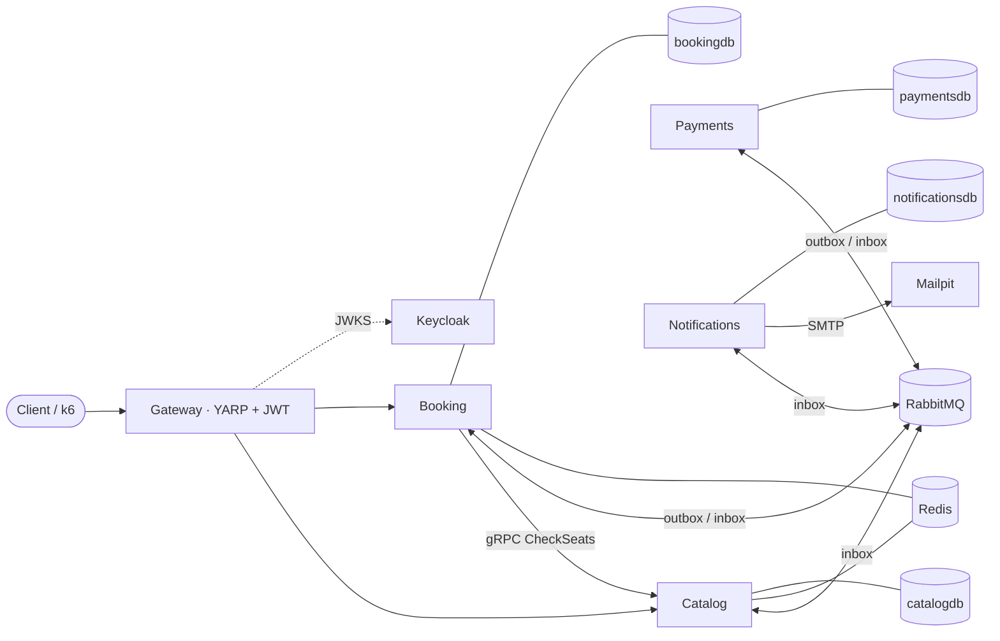
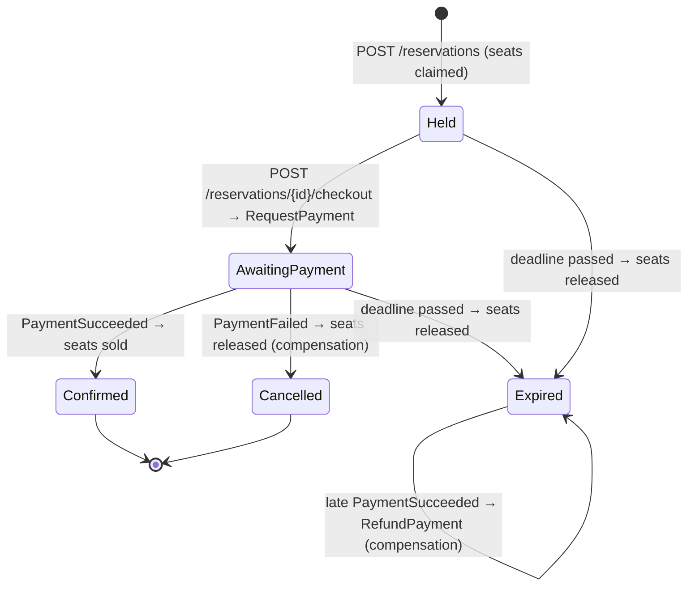

# TicketHub — Implementation Plan

> **Status:** Implemented. All six phases are complete; see the README for results. The plan was approved with one instruction: *no more technology than necessary; keep it clean, no over-engineering.* Revision 1 applies that instruction and overrides anything else in this document. "Changes found during implementation" records where the build differs from the plan, and why.

## Revision 1 — simplifications

| Removed or simplified | Why |
|---|---|
| Redis admission lock (old Task 3.4) | Optimistic concurrency already guarantees zero overbooking, and the brief asks for one mechanism *or* the other. Redis is used only for the catalog cache. ADR-0004 explains why a Redis lock would not add safety. |
| `Idempotency-Key` support (old Task 3.5, RF-4) | Not in the brief. Listed as future work. |
| Polly pipelines in Payments and Notifications (old Task 3.2) | Message-level retries already cover transient failures in consumers. HTTP resilience stays where the brief puts it: the Booking → Catalog gRPC client. |
| Four retry delay levels | One retry queue with a fixed delay (5 s) and at most 5 attempts, then dead-letter. |
| Dead-letter replay endpoint | Not in the brief. The admin endpoint lists dead letters. |
| `sell-out.js` k6 scenario | Not in the brief. Only the same-seat race remains. |
| Separate `*.Domain`, `*.UnitTests` and `*.IntegrationTests` projects | One project per service, with a `Domain/` folder. One test project per service, with `Domain/` (pure unit tests) and `Integration/` (Testcontainers) folders. One shared `TicketHub.Contracts` project for all messages. |

## Changes found during implementation

| Planned | Built | Why |
|---|---|---|
| `AddStandardResilienceHandler` (with retries) on the gRPC client | gRPC-native retry policy, plus a Http.Resilience circuit breaker and attempt timeout | An HTTP-level retry cannot replay a gRPC request body, so the retry hung. A test exposed this (ADR-0008). |
| Cache the seat map, invalidate on change | Cache only the static layout and read status fresh | No invalidation races, and no stale availability (ADR-0009). |
| One HTTP/2 connection to Catalog | `EnableMultipleHttp2Connections` | The k6 run showed calls queuing behind the 100-stream limit of a single connection. |
| Trace everything | Polling queries run under `SuppressInstrumentationScope` | Polling produced thousands of root traces a minute. |
| ADR-0013 (testing strategy) | The README's Testing section | The decision fits in one table; a separate record added nothing. |
| A generated Keycloak realm file with 500 load-test users | k6 `setup()` creates the users through the admin API | One less generated artefact to keep in sync. |

**Goal:** An event ticketing platform built as .NET 10 microservices with event-driven workflows, which can be shown never to sell the same seat twice.

**Architecture:** Four services sit behind a YARP gateway: Catalog, Booking, Payments and Notifications. Each owns its own PostgreSQL database. Booking is the system of record for seat allocation and orchestrates the checkout saga. Services call each other synchronously only where a fresh answer is required (Booking → Catalog over gRPC). Everything else goes through RabbitMQ with a transactional outbox and idempotent consumers. Aspire orchestrates the system locally, and a docker-compose file serves people who don't use Aspire.

**Tech stack:**
- **Runtime and APIs:** .NET 10 (LTS), Aspire 13.6, ASP.NET Core minimal APIs, gRPC
- **Data and messaging:** EF Core 10 + Npgsql, RabbitMQ.Client 7, Redis (HybridCache L2 for the catalog)
- **Edge and identity:** YARP 2.3, Keycloak 26 (OIDC/JWT)
- **Operations:** OpenTelemetry, Microsoft.Extensions.Http.Resilience, MailKit + Mailpit
- **Testing and CI:** xUnit v3 + Shouldly + NSubstitute, Testcontainers, Aspire.Hosting.Testing, k6, GitHub Actions

**Spec:** §1 restates the project brief. §10 traces each requirement to the task that implements it.

---

## 1. Requirements (from the brief)

**Services**
- **Catalog:** events, venues and seats (PostgreSQL).
- **Booking:** reservations (PostgreSQL).
- **Payments:** a payment simulator with configurable random failures and latency.
- **Notifications:** a worker that sends email to Mailpit.
- **Gateway:** an API gateway on YARP.

**Platform**
- **Messaging:** RabbitMQ, through RabbitMQ.Client or Wolverine; the choice is justified in an ADR.
  - **Not allowed:** MassTransit, MediatR and AutoMapper.
- **Delivery guarantees:**
  - Booking writes messages through a transactional outbox.
  - Consumers are idempotent (inbox/deduplication).
- **Saga:** reserve → pay → confirm.
  - **Compensation:** seats are released when payment fails.
  - **Expiry:** seats are also released when a hold expires after **10 minutes**.
- **Overbooking:**
  - Prevented with optimistic concurrency, a Redis distributed lock, or both.
  - Redis also caches the catalog.
- **Sync calls:** gRPC between Booking and Catalog to check availability.
- **Resilience:** Microsoft.Extensions.Http.Resilience (retry, circuit breaker, timeout).
- **Observability:** OpenTelemetry, with distributed traces visible in the Aspire dashboard, plus health checks.
- **Auth:** Keycloak in a container (OIDC); JWTs are validated at the gateway **and** in the services.

**Features**
1. List events and view the seat map with availability.
2. Hold seats temporarily, then pay and confirm; a background service expires holds.
3. A k6 script in which 500 users try to buy the same seat proves zero overbooking. The results go in the README.
4. An admin endpoint shows saga state and failed (dead-lettered) messages.

**Quality**
- **Unit tests:** domain tests per service, using xUnit, Shouldly and NSubstitute.
- **Integration tests:** Testcontainers (Postgres, RabbitMQ, Redis).
- **End-to-end tests:** at least one test of the complete flow, using Aspire.Hosting.Testing.
- **Containers:**
  - Multi-stage Dockerfiles.
  - An alternative docker-compose file.
  - Host ports only in the range **5200–5299**.
- **CI:** GitHub Actions with build and tests per service.
- **README:**
  - Mermaid diagrams for the architecture and the booking flow (a sequence diagram).
  - The k6 results.
  - Trade-offs: why microservices here, what a modular monolith would look like, and eventual consistency.
- **ADRs:** the main ADRs live in `docs/adr/`.

**Way of working**
- Phases follow the order the brief sets: the happy path end to end first, then saga, resilience, auth and load.
- Each phase finishes with build and tests green before the next one starts.
- Commits are small and follow Conventional Commits.
- Code, commits and docs are in English.

## 2. Global constraints

These apply to every task.

**Toolchain**
- **SDK:** .NET SDK 10.0.1xx pinned in `global.json` (`rollForward: latestFeature`), targeting `net10.0`.
- **Build settings:** `Nullable` enabled and `TreatWarningsAsErrors=true`.
- **Packages:** Central Package Management (`Directory.Packages.props`), with Aspire packages pinned at 13.6.x.

**Dependencies**
- **Banned:** MassTransit, MediatR, AutoMapper, and any other mediator or object-mapping library.
- **Preview packages:** none.
  - `Aspire.Hosting.Keycloak` is preview-only, so Keycloak is added as a plain container.
- **Messaging client:** RabbitMQ.Client 7.x (see ADR-0002).
- **Test stack:** xUnit v3, Shouldly, NSubstitute, Testcontainers 4.x, Aspire.Hosting.Testing.

**Containers and ports**
- **Images:** pulled only from `docker.io` and `mcr.microsoft.com`, with pinned tags.
  - Keycloak uses `docker.io/keycloak/keycloak`, not quay.io.
- **Host ports:** in **5200–5299** only.
  - Aspire uses 5200–5249 and compose uses 5250–5299, so both can run at the same time (§6).

**Domain values**
- **Hold duration:** **10 minutes**, configurable as `Booking:Holds:Duration`.
- **Seats per reservation:** at most **6**, configurable as `Booking:Holds:MaxSeats`. The brief doesn't set this; it is my choice.
- **Money:** `decimal` in the domain and integer minor units on gRPC. The only currency is `EUR`.
- **IDs:** UUIDv7 (`Guid.CreateVersion7()`) for every generated ID.

**Process**
- **Language:** English for code, commits and docs.
- **Commits:** Conventional Commits, one logical change per commit.
- **Branch:** `claude/eager-dirac-wjl5ze`.
- **TDD:** in each task, the tests listed are written first and seen failing before the implementation.
- **Phase gate:**
  1. `dotnet build TicketHub.slnx -c Release` finishes with 0 warnings.
  2. `dotnet test` passes for the whole solution: unit, integration and e2e.
  3. GitHub Actions is green on the pushed commit.
  4. A short phase summary is posted.

## 3. Architecture

### 3.1 Services and data ownership

| Service | Owns (database) | Exposes | Publishes | Consumes |
|---|---|---|---|---|
| **Gateway** | — | `/catalog/**`, `/booking/**`, `/admin/**` | — | — |
| **Catalog** | Venues, seats, events, prices; seat-status projection (`catalogdb`) | REST: events and seat map. gRPC: `CheckSeats` | — | `SeatAvailabilityChanged` |
| **Booking** | Seat allocations, reservations (which are the saga state), reservation timeline, dead-letter archive (`bookingdb`) | REST: reservations, checkout, admin | `SeatAvailabilityChanged`, `ReservationConfirmed`, `ReservationCancelled`, `ReservationExpired`, `RequestPayment`, `RefundPayment` | `PaymentSucceeded`, `PaymentFailed`, `PaymentRefunded`, dead letters |
| **Payments** | Payments, plus the simulated provider's charge log (`paymentsdb`) | Health endpoints only | `PaymentSucceeded`, `PaymentFailed`, `PaymentRefunded` | `RequestPayment`, `RefundPayment` |
| **Notifications** | Inbox (`notificationsdb`) | Health endpoints only | — | `ReservationConfirmed`, `ReservationCancelled`, `ReservationExpired` |

**Infrastructure**
- **PostgreSQL:** one server, with one database per service. No service reads another service's database.
- **RabbitMQ:** the message broker.
- **Redis:** catalog cache and hold admission lock.
- **Keycloak:** the identity provider.
- **Mailpit:** the SMTP sink, with a web UI.



### 3.2 Where "availability" lives

This is the central design call; ADR-0001 and ADR-0005 record it.

A seat is available when two independent conditions hold:

| Question | Owner | How it is answered |
|---|---|---|
| *Can this seat be sold for this event, and at what price?* The seat must exist, must not be blocked, and the event must be on sale. | **Catalog** | Synchronous gRPC `CheckSeats`, called by Booking when it creates a hold. Catalog is authoritative for prices, so the client never sends one. |
| *Is the seat free right now* (not held or sold)? | **Booking** | Booking's own `seat_allocations` table, changed in the **same ACID transaction** as the reservation and the outbox row. |

**Why Booking owns the allocation**
- Creating the reservation and claiming its seats is one transaction in one database, so there is no distributed transaction at the moment of contention.
- If Catalog owned the seat status, every hold would need a cross-service saga just to claim a seat.

**The seat map**
- Catalog serves the seat map from its own **projection**, `event_seat_status`, fed by Booking's `SeatAvailabilityChanged` events and cached in Redis.
- The map is therefore **eventually consistent**: it can show a seat as free a few hundred milliseconds after someone has held it.
- That is acceptable because the authoritative check happens when the hold is created. If the seat has gone, the client gets `409 Conflict` and refreshes the map.

**Allocation rows**
- Booking creates `seat_allocations` rows lazily, on the first attempt to hold a seat (`INSERT … ON CONFLICT DO NOTHING`).
- A seat with no row has never been claimed.
- This avoids replicating every venue seat into Booking ahead of time.

### 3.3 Message catalogue

Contracts are versioned by routing key. All messages go through one topic exchange, `tickethub.events`.

**Ownership rule:** events belong to the service that publishes them, and commands belong to the service that handles them.

| Message | Kind | Producer → Consumer | Routing key |
|---|---|---|---|
| `SeatAvailabilityChanged` | event | Booking → Catalog | `booking.seat-availability-changed.v1` |
| `ReservationConfirmed` | event | Booking → Notifications | `booking.reservation-confirmed.v1` |
| `ReservationCancelled` | event | Booking → Notifications | `booking.reservation-cancelled.v1` |
| `ReservationExpired` | event | Booking → Notifications | `booking.reservation-expired.v1` |
| `RequestPayment` | command | Booking → Payments | `payments.request-payment.v1` |
| `RefundPayment` | command | Booking → Payments | `payments.refund-payment.v1` |
| `PaymentSucceeded` | event | Payments → Booking | `payments.payment-succeeded.v1` |
| `PaymentFailed` | event | Payments → Booking | `payments.payment-failed.v1` |
| `PaymentRefunded` | event | Payments → Booking | `payments.payment-refunded.v1` |

**Queues**

| Queue | Bound messages |
|---|---|
| `catalog.booking-events` | `SeatAvailabilityChanged` |
| `payments.commands` | `RequestPayment`, `RefundPayment` |
| `booking.payment-events` | `PaymentSucceeded`, `PaymentFailed`, `PaymentRefunded` |
| `notifications.booking-events` | `ReservationConfirmed`, `ReservationCancelled`, `ReservationExpired` |
| `tickethub.dead-letters` | Dead-lettered messages from all queues |

**Retry queues:** each consumer queue also gets one retry queue per delay level.

### 3.4 Reservation lifecycle

The orchestrated saga lives in Booking; see ADR-0006. The `Reservation` aggregate *is* the saga state. It enforces the transitions, and each transition is appended to `reservation_timeline` so the admin endpoint can show it.



**Deadline**
- The deadline is absolute: hold time + 10 min.
- Checkout after the deadline returns `410 Gone`.

**Duplicate events**
- A `PaymentSucceeded` that arrives after `Expired` never resurrects the reservation. Booking issues `RefundPayment` instead.
- Duplicate payment events are no-ops.

**Concurrent updates**
- The expiry job and payment handlers can race on the same reservation.
- They are serialised by the reservation's optimistic concurrency token, and the loser re-reads and re-applies.

### 3.5 Preventing overbooking

ADR-0004 records this decision.

**Guarantee: optimistic concurrency in PostgreSQL**
- `SeatAllocation.Version` (a `long`) is an EF Core concurrency token. The update is `UPDATE … WHERE event_id=@e AND seat_id=@s AND version=@v`.
- Of N concurrent claimants, one updates the row. The others match 0 rows, get `DbUpdateConcurrencyException`, retry once, then see `Held` and return `409`.
- I chose an explicit version over `xmin` because the same monotonic number orders Catalog's projection (§3.6). `xmin` is a transaction ID, not a per-row sequence.
- Multi-seat holds are all-or-nothing in one transaction.
- Seats are always updated in ascending `SeatId` order, so two overlapping holds cannot deadlock.

**Optimisation, not a guarantee: Redis admission lock**
- The lock is optional, behind `Booking:Holds:RedisAdmission:Enabled`.
- Before the database transaction, Booking runs `SET seat-lock:{event}:{seat} <token> NX PX 5000` for each seat in sorted order.
  - If any key is already taken, it returns `409` without touching PostgreSQL.
- Keys are released with a compare-and-delete Lua script.
- The lock **fails open**: if Redis is down, holds go straight to the database, which still guarantees correctness.
- Redis is deliberately not the correctness mechanism. A Redis/Redlock lock gives no safety under process pauses or clock drift without fencing tokens, and the version column already plays that role.
- k6 runs in both modes; the README reports database conflicts and latency for each.

### 3.6 Messaging mechanics

ADR-0002, ADR-0003, ADR-0007 and ADR-0011 cover this.

**Outbox**
- A handler calls `IOutbox.Enqueue(message)`. This adds an `outbox_messages` row to the same `DbContext`, which commits atomically with the business change.
- `OutboxRelay` is a `BackgroundService` that publishes the rows:
  1. Wakes when a commit signals it in-process, with a 1 s polling fallback.
  2. Claims a batch with `SELECT … FOR UPDATE SKIP LOCKED`, which is safe across replicas.
  3. Publishes with **publisher confirms**.
  4. Marks each row sent.
- Sent rows are purged after 24 h.

**Delivery semantics**
- Delivery is **at least once**. The relay can crash after publishing but before marking a row as sent.
- Every consumer therefore deduplicates.

**Inbox**
- Each delivery runs in one transaction:
  1. Insert `(message_id, consumer)` into `inbox_messages`.
  2. Run the handler.
  3. `SaveChanges`.
  4. Commit.
  5. Ack.
- If the insert hits the primary key, the message is a duplicate: it is acked and skipped.
- Handlers that write to the database get an exactly-once *effect*.
- Notifications' side effect is SMTP, which can't join the transaction. It can send a duplicate email if the process crashes between sending and committing. That is documented, not hidden.

**Ordering**
- Ordering is not guaranteed: replicas and retries reorder messages.
- Consumers are order-tolerant. For example, Catalog applies a seat status only if its `Version` is greater than the stored one.

**Retries and dead letters**
- A failed handler is retried with delays of **1 s, 5 s, 30 s, 2 min**. Each delay is a separate retry queue with a queue-level TTL, which avoids head-of-line blocking.
- After 5 attempts, the message goes to `tickethub.dead-letters` with headers for the original queue, attempt count and exception.
- Booking's ops module archives dead letters to `ops.dead_letters`, where they can be listed and replayed.

**Tracing**
- The W3C `traceparent` is captured when a message is enqueued and stored in the outbox row.
- The relay restores it as the parent of the *publish* span and injects it into AMQP headers.
- The consumer extracts it.
- One trace therefore spans HTTP → outbox → broker → consumer, even though the relay publishes later on another thread.

## 4. Decisions to confirm before coding

Each item has a recommendation. Approving the plan approves these, unless you say otherwise.

1. **RabbitMQ.Client over Wolverine (recommended).**
   - With Wolverine, the outbox, inbox, retries and saga would be configuration. You would be defending a framework's behaviour rather than your own code.
   - Hand-rolling them on RabbitMQ.Client costs roughly 600 lines in one building block, and each line is explainable in an interview.
   - ADR-0002 states honestly that a product team would probably choose Wolverine.
2. **Booking owns seat allocation; the gRPC call checks *sellability and price*; the seat map is an async projection (§3.2).**
   - This is how I read "gRPC between Booking and Catalog to check availability".
   - The alternative is to have Catalog own the seat status. That needs a cross-service transaction for every hold.
3. **Optimistic concurrency is the guarantee; Redis is an optional admission lock that fails open, measured by k6 (§3.5).**
   - This is both options from the brief, with one clearly marked as the guarantee.
4. **The saga is orchestrated in Booking, with the `Reservation` aggregate as its state; a late payment after expiry triggers a refund (§3.4).**
5. **The user identity seam until auth arrives in Phase 4.**
   - Phases 1–3 read the user from `X-User-Id` / `X-User-Email` headers behind an `ICurrentUser` interface.
   - Phase 4 replaces this with JWT claims and **deletes** the header implementation.
   - This keeps the order you asked for (auth after saga and resilience) without changing the API shape later.
6. **Port split: Aspire 5200–5249, compose 5250–5299 (§6).**
   - Every fixed port is in range.
   - Aspire's internal proxy targets use ephemeral ports that the OS picks from free ones, so they cannot collide with your other projects.

## 5. Solution layout

```
TicketHub/
├─ TicketHub.slnx · global.json · Directory.Build.props · Directory.Packages.props · .editorconfig
├─ src/
│  ├─ AppHost/TicketHub.AppHost/                 Aspire orchestration
│  ├─ ServiceDefaults/TicketHub.ServiceDefaults/ OTel, health, resilience defaults, service discovery
│  ├─ BuildingBlocks/
│  │  ├─ TicketHub.BuildingBlocks/               Result/Error, Money, ICurrentUser, ProblemDetails mapping
│  │  └─ TicketHub.Messaging/                    RabbitMQ topology, outbox, inbox, retries/DLQ, tracing
│  ├─ Gateway/TicketHub.Gateway/
│  ├─ Catalog/
│  │  ├─ TicketHub.Catalog.Domain/               no infrastructure dependencies
│  │  └─ TicketHub.Catalog/                      host: REST, gRPC (Protos/catalog.proto), consumers, EF
│  ├─ Booking/
│  │  ├─ TicketHub.Booking.Domain/
│  │  ├─ TicketHub.Booking.Contracts/            events Booking publishes
│  │  └─ TicketHub.Booking/                      host: features (vertical slices), saga handlers, expiry, ops/admin
│  ├─ Payments/
│  │  ├─ TicketHub.Payments.Contracts/           commands Payments handles + events it publishes
│  │  └─ TicketHub.Payments/                     host; Domain/ folder (small domain → no separate project)
│  └─ Notifications/TicketHub.Notifications/     worker host; Emails/ composition
├─ tests/
│  ├─ TicketHub.TestKit/                         Testcontainers fixtures, test JWTs, fakes, polling helpers
│  ├─ TicketHub.Messaging.IntegrationTests/
│  ├─ TicketHub.{Catalog,Booking,Payments,Notifications}.UnitTests/
│  ├─ TicketHub.{Catalog,Booking,Payments,Notifications,Gateway}.IntegrationTests/
│  └─ TicketHub.EndToEnd.Tests/                  Aspire.Hosting.Testing
├─ deploy/  docker-compose.yml · keycloak/ (realm import) · postgres/ (init.sql)
├─ loadtests/k6/
├─ scripts/
├─ requests/tickethub.http                       manual API calls
└─ docs/  PLAN.md · adr/ · images/
```

**Project boundaries**
- Separate Domain projects exist only where the domain is rich enough to need enforced boundaries (Catalog, Booking).
- Payments and Notifications keep their domain in a folder.
- ADR-0012 explains why the number of projects follows complexity rather than a template.

**Feature code**
- Feature code is organised by vertical slice: `Features/HoldSeats/{Endpoint,Handler,Request}.cs`.
- Handlers are plain classes injected into minimal-API endpoints.
- Mapping is explicit, using `ToDto()` methods.

## 6. Ports

| Resource | Aspire (host) | Compose (host) | Container |
|---|---|---|---|
| Gateway | **5200** | **5250** | 8080 |
| Aspire dashboard UI | 5201 | 5251 (standalone dashboard) | 18888 |
| Dashboard OTLP / resource service | 5202 / 5203 | internal only | 18889 |
| Catalog HTTP / gRPC (h2c) | 5210 / 5211 | internal only | 8080 / 8081 |
| Booking · Payments · Notifications | 5212 · 5213 · 5214 | internal only | 8080 |
| Keycloak | 5220 | 5260 | 8080 |
| Mailpit UI | 5221 | 5261 | 8025 |
| RabbitMQ management / AMQP | 5222 / 5223 | 5262 / 5263 | 15672 / 5672 |
| PostgreSQL | 5224 | 5264 | 5432 |
| Redis | 5225 | 5265 | 6379 |

E2E tests run the AppHost with randomised ports, so they don't clash with a running development session.

## 7. Phases and tasks

Every task lists the key files it adds, the interfaces later tasks rely on, the tests that prove it (written first), and its commit or commits. Tests tagged **RF-n** pin a Review Focus item (§8).

---

### Phase 0 — Repository foundation

**Outcome:** an empty but buildable solution, with CI, conventions and the first two ADRs.

**Task 0.1 — Solution skeleton**
- **Files:**
  - Root files: `global.json`, `Directory.Build.props`, `Directory.Packages.props`, `.editorconfig`, `.gitignore`, `.gitattributes`, `TicketHub.slnx`.
  - Aspire projects: `src/AppHost/…`, `src/ServiceDefaults/…`.
  - `README.md` (skeleton), `LICENSE` (MIT).
- **ServiceDefaults:**
  - Starts from the Aspire template.
  - Health endpoints are mapped in every environment, because compose healthchecks and probes need them: `/health/live` checks the process itself, and `/health/ready` checks the dependencies.
  - The gateway never routes to these endpoints.
- **Verify:**
  - `dotnet build TicketHub.slnx -c Release` → 0 warnings.
  - `dotnet run --project src/AppHost/TicketHub.AppHost` starts the dashboard on 5201.
- **Commits:**
  - `chore: scaffold solution with central package management`
  - `feat(apphost): add Aspire AppHost and ServiceDefaults`

**Task 0.2 — ADR framework and CI baseline**
- **Files:**
  - ADRs: `docs/adr/README.md` (index and template: Context · Decision · Consequences · Alternatives · Failure modes), `docs/adr/0001-service-boundaries-and-data-ownership.md`, `docs/adr/0002-messaging-with-rabbitmq-client.md`.
  - CI: `.github/workflows/build.yml` (restore, then build the whole solution), `.github/workflows/_dotnet-tests.yml` (a reusable workflow that each service calls with its test projects and path filters).
- **Verify:** the push produces a green `build` run.
- **Commits:**
  - `docs(adr): add ADR template, service boundaries and messaging decisions`
  - `ci: add solution build and reusable test workflow`

**Gate 0:** build green, CI green.

---

### Phase 1 — Happy path: browse → hold → seat map updated by a message

**Outcome:** through the gateway, a user lists events, opens a seat map, and holds seats. Booking validates them over gRPC, claims them with optimistic concurrency and writes an outbox message. Catalog consumes the message, and the seat map shows the seats as `Held`.

There is no payment yet, and no auth yet (the header seam described in §4 stands in for the user).

**Task 1.1 — Building blocks: shared primitives and messaging (outbox, inbox, topology, tracing)**
- **Files:** `src/BuildingBlocks/TicketHub.BuildingBlocks/**`, `src/BuildingBlocks/TicketHub.Messaging/**`, `tests/TicketHub.Messaging.IntegrationTests/**`
- **Produces:**
  ```csharp
  // TicketHub.BuildingBlocks — technical primitives only, no domain concepts
  public readonly record struct Money(decimal Amount, string Currency);
  public sealed record Error(string Code, string Message, ErrorKind Kind); // Kind: Validation | NotFound | Conflict | Gone | Unprocessable | Unavailable
  public class Result { bool IsSuccess; Error? Error; }  public sealed class Result<T> : Result { T Value; }
  public interface ICurrentUser { string UserId { get; } string Email { get; } }
  public static IResult ToProblem(this Error error); // ErrorKind → 400/404/409/410/422/503 ProblemDetails

  // TicketHub.Messaging
  public interface IIntegrationMessage;
  [AttributeUsage(AttributeTargets.Class)] public sealed class MessageTypeAttribute(string name) : Attribute; // e.g. "booking.seat-availability-changed.v1"
  public interface IOutbox { void Enqueue<T>(T message, Guid? correlationId = null) where T : class, IIntegrationMessage; }
  public interface IMessageHandler<in T> where T : class, IIntegrationMessage
  { Task HandleAsync(T message, MessageContext context, CancellationToken ct); }
  public sealed record MessageContext(Guid MessageId, string MessageType, Guid? CorrelationId, int Attempt, DateTimeOffset OccurredAt);
  public static MessagingBuilder AddTicketHubMessaging<TDbContext>(this IHostApplicationBuilder builder, string connectionName = "rabbitmq") where TDbContext : DbContext;
  // MessagingBuilder.Publishes<T>(); MessagingBuilder.Consumes<T, THandler>(string queue);
  public static ModelBuilder AddMessagingTables(this ModelBuilder modelBuilder); // outbox_messages, inbox_messages
  ```
- **Behaviour:**
  - The outbox, relay and inbox work as described in §3.6.
  - Serialisation is System.Text.Json, using a type registry keyed by the `MessageType` name, not CLR names.
  - Uses the `TicketHub.Messaging` `ActivitySource` and `Meter`.
  - Phase 1 failure policy: `nack(requeue:false)` into a dead-letter exchange, which feeds the `tickethub.dead-letters` queue. Phase 2 adds delayed retries.
- **Tests** (Testcontainers Postgres + RabbitMQ):
  - `Enqueued_message_is_published_after_commit`
  - `Enqueued_message_is_not_published_when_transaction_rolls_back`
  - `Duplicate_delivery_invokes_handler_once` (**RF-1**): the same `MessageId` is published twice; the handler's row count is 1.
  - `Handler_exception_rolls_back_handler_changes_and_inbox_row`
  - `Relay_instances_do_not_publish_the_same_row_twice`: two relays run over 200 rows; every message arrives exactly once.
  - `Trace_context_flows_from_enqueue_to_handler`: the `ActivityListener` sees the same `TraceId`.
- **Commits:**
  - `feat(messaging): add transactional outbox with relay`
  - `feat(messaging): add idempotent consumer with inbox`
  - `feat(messaging): propagate trace context through outbox and broker`

**Task 1.2 — Catalog domain and persistence**
- **Files:** `src/Catalog/TicketHub.Catalog.Domain/**`, `src/Catalog/TicketHub.Catalog/Data/**` (DbContext, configurations, migrations, `DevelopmentSeed`), `tests/TicketHub.Catalog.UnitTests/**`
- **Produces:**
  ```csharp
  public sealed class Venue    { Guid Id; string Name; IReadOnlyList<Seat> Seats; }
  public sealed class Seat     { Guid Id; string Section; string Row; int Number; bool IsBlocked; string Label; }
  public sealed class Event    { Guid Id; string Name; Guid VenueId; DateTimeOffset StartsAt, SalesOpenAt, SalesCloseAt;
                                 bool IsOnSale(DateTimeOffset now); Money PriceFor(Seat seat); } // price per section
  public enum SeatStatus { Available, Held, Sold }
  public sealed class EventSeatStatus { Guid EventId; Guid SeatId; SeatStatus Status; long Version;
                                        bool Apply(SeatStatus status, long version); } // false when stale
  ```
- **Seed data:**
  - Two fictional events.
  - `Load Test Arena` has 1 section of 20 × 50 seats.
- **Tests:**
  - `Event_is_on_sale_only_between_sales_open_and_close`
  - `Price_is_taken_from_the_seat_section`
  - `Status_update_with_lower_or_equal_version_is_ignored`
  - `Domain_assembly_references_no_infrastructure_packages`
- **Commit:** `feat(catalog): add venue, seat and event domain with EF persistence`

**Task 1.3 — Catalog API, gRPC and seat-map projection**
- **Files:**
  - API: `src/Catalog/TicketHub.Catalog/Features/{ListEvents,GetEvent,GetSeatMap}/**`, `Grpc/SeatSellabilityService.cs`, `Protos/catalog.proto`, `Features/SeatAvailability/SeatAvailabilityChangedHandler.cs`.
  - Contracts: `src/Booking/TicketHub.Booking.Contracts/SeatAvailabilityChanged.cs`.
  - Tests: `tests/TicketHub.Catalog.IntegrationTests/**`.
- **Produces:**
  ```proto
  package tickethub.catalog.v1;
  service SeatSellability { rpc CheckSeats(CheckSeatsRequest) returns (CheckSeatsResponse); }
  message CheckSeatsRequest  { string event_id = 1; repeated string seat_ids = 2; }
  message CheckSeatsResponse { bool event_found = 1; bool event_on_sale = 2; repeated SeatInfo seats = 3; }
  message SeatInfo { string seat_id = 1; bool exists = 2; bool sellable = 3; int64 price_minor = 4; string currency = 5; string label = 6; }
  ```
  ```csharp
  [MessageType("booking.seat-availability-changed.v1")]
  public sealed record SeatAvailabilityChanged(Guid EventId, IReadOnlyList<SeatStatusChange> Seats) : IIntegrationMessage;
  public sealed record SeatStatusChange(Guid SeatId, string Status, long Version);
  ```
- **REST endpoints:**
  - `GET /events?page=&pageSize=` (pageSize ≤ 100)
  - `GET /events/{id}`
  - `GET /events/{id}/seat-map`: sections, then rows, then seats with `status` and price. A seat with no projection row is `Available`.
- **gRPC endpoint:** served on a dedicated HTTP/2-only (h2c) Kestrel endpoint, port 5211 in Aspire.
- **OpenAPI:** the built-in document at `/openapi/v1.json`, in Development only.
- **Tests:**
  - `Seat_map_returns_layout_with_availability`
  - `List_events_returns_events_ordered_by_start_date`
  - `Unknown_event_returns_404`
  - `CheckSeats_returns_prices_and_flags_unknown_and_blocked_seats`
  - `CheckSeats_reports_event_not_on_sale_outside_sales_window`
  - `Projection_applies_out_of_order_events_by_version`: v2 arrives before v1; the final status is v2's.
- **Commits:**
  - `feat(catalog): add events and seat-map endpoints`
  - `feat(catalog): add CheckSeats gRPC service`
  - `feat(catalog): project seat availability from booking events`

**Task 1.4 — Booking: hold seats**
- **Files:** `src/Booking/TicketHub.Booking.Domain/**`, `src/Booking/TicketHub.Booking/{Data,Features/HoldSeats,Features/GetReservation,Catalog}/**`, `tests/TicketHub.Booking.{UnitTests,IntegrationTests}/**`
- **Produces:**
  ```csharp
  public enum AllocationStatus { Available, Held, Sold }
  public sealed class SeatAllocation // PK (EventId, SeatId); Version = concurrency token
  { Result Hold(Guid reservationId); Result Release(Guid reservationId); Result Sell(Guid reservationId); }
  public enum ReservationStatus { Held, AwaitingPayment, Confirmed, Cancelled, Expired }
  public sealed record CustomerRef(string UserId, string Email);
  public sealed record ReservedSeat(Guid SeatId, string Label, Money Price);
  public sealed class Reservation
  { static Result<Reservation> Hold(Guid id, Guid eventId, CustomerRef customer, IReadOnlyList<ReservedSeat> seats,
                                    DateTimeOffset now, TimeSpan holdDuration, int maxSeats);
    ReservationStatus Status; DateTimeOffset HoldExpiresAt; Money Total; long Version; }
  // Booking-side port over the generated gRPC client (named to avoid clashing with the generated SeatSellability class)
  public interface ICatalogSeatChecker { Task<SeatCheckResult> CheckAsync(Guid eventId, IReadOnlyCollection<Guid> seatIds, CancellationToken ct); }
  public sealed record SeatCheckResult(bool EventFound, bool EventOnSale, IReadOnlyList<SeatCheck> Seats);
  public sealed record SeatCheck(Guid SeatId, bool Exists, bool Sellable, Money Price, string Label);
  public sealed record HoldSeatsCommand(Guid EventId, IReadOnlyList<Guid> SeatIds);
  public sealed record ReservationResponse(Guid Id, string Status, DateTimeOffset HoldExpiresAt, decimal Total, string Currency, IReadOnlyList<ReservedSeatResponse> Seats);
  public sealed record ReservedSeatResponse(Guid SeatId, string Label, decimal Price);
  public sealed class HoldSeatsHandler { Task<Result<ReservationResponse>> HandleAsync(HoldSeatsCommand command, ICurrentUser user, CancellationToken ct); }
  public sealed class HoldOptions { TimeSpan Duration = TimeSpan.FromMinutes(10); int MaxSeats = 6; }
  ```
- **Handler flow:**
  1. Validate the request.
  2. Call gRPC `CheckSeats`.
  3. Insert any missing allocation rows lazily.
  4. Load the allocations ordered by `SeatId` and run the domain hold.
  5. Enqueue `SeatAvailabilityChanged`.
  6. `SaveChanges`.
  7. On `DbUpdateConcurrencyException`, retry the whole command once.
- **Error → HTTP mapping** (via ProblemDetails):

  | Error | Status |
  |---|---|
  | Validation (empty, duplicate seats, more than 6) | 400 |
  | Unknown event or seat | 404 |
  | `SeatUnavailable` (with the conflicting seat IDs) | 409 |
  | Event not on sale | 422 |
- **Endpoints:** `POST /reservations` → `201 Created`; `GET /reservations/{id}`.
- **Time:** `TimeProvider` is injected everywhere, and tests use `FakeTimeProvider`.
- **Unit tests:**
  - `Hold_sets_expiry_ten_minutes_after_now`
  - `Hold_rejects_duplicate_seats`
  - `Hold_rejects_more_than_max_seats`
  - `Hold_total_is_sum_of_seat_prices`
  - `Allocation_cannot_be_held_when_already_held_or_sold`
  - `Allocation_release_by_other_reservation_is_rejected`
  - `Domain_assembly_references_no_infrastructure_packages`
- **Integration tests** (Postgres container, fake `ICatalogSeatChecker`):
  - `Parallel_holds_for_same_seat_produce_exactly_one_reservation`: 100 concurrent requests; exactly 1 × 201 and 99 × 409; one allocation row in `Held`.
  - `Overlapping_multi_seat_holds_in_opposite_order_are_all_or_nothing` (**RF-3**): A=[s1,s2] and B=[s2,s1], × 50 rounds. Each round has exactly one winner holding both seats, no 500s and no partial holds.
  - `Hold_writes_SeatAvailabilityChanged_to_outbox_in_same_transaction`
  - `Hold_returns_404_for_unknown_seat`
  - `Hold_returns_422_when_event_not_on_sale`
- **Commits:**
  - `feat(booking): add seat allocation and reservation domain`
  - `feat(booking): hold seats with optimistic concurrency`
  - `feat(booking): validate seats via Catalog gRPC`

**Task 1.5 — Gateway and AppHost wiring**
- **Files:** `src/Gateway/TicketHub.Gateway/**`, `src/AppHost/TicketHub.AppHost/AppHost.cs`, `tests/TicketHub.Gateway.IntegrationTests/**`, `requests/tickethub.http`
- **Routing:**
  - YARP, with service-discovery destinations (`Microsoft.Extensions.ServiceDiscovery.Yarp`).
  - `/catalog/{**}` goes to Catalog and `/booking/{**}` goes to Booking, with the prefix stripped.
  - No retries at the gateway: retrying non-idempotent POSTs at the edge is unsafe.
- **AppHost resources:**
  - `postgres` (with `catalogdb` and `bookingdb`) and `rabbitmq` (with the management plugin).
  - `catalog`, `booking` and `gateway`.
  - Migrations run at startup when `Database:MigrateOnStartup=true`. EF Core's migration lock makes this safe with replicas.
- **Tests:**
  - `Routes_catalog_and_booking_prefixes_to_their_clusters`, using in-memory test destinations.
  - `Unknown_route_returns_404`
- **Commit:** `feat(gateway): route catalog and booking through YARP`

**Task 1.6 — First end-to-end test and per-service CI**
- **Files:** `tests/TicketHub.EndToEnd.Tests/**` (a shared `AppHostFixture`, one AppHost per test collection), `.github/workflows/{messaging,catalog,booking,gateway,e2e}.yml`
- **Test:** `Customer_holds_seat_and_seat_map_shows_it_held`. The test calls the gateway, then polls the seat map for up to 10 s until the seat is `Held`.
- **Commits:**
  - `test(e2e): cover hold-to-projection flow with Aspire.Hosting.Testing`
  - `ci: run tests per service with path filters`
- **ADRs:** `0003-transactional-outbox-and-idempotent-consumers`, `0004-preventing-overbooking` (the concurrency part), `0005-seat-availability-sync-check-async-projection`, `0012-code-organisation`.

**Gate 1:** build green, all tests green, CI green.

---

### Phase 2 — Checkout saga, payments, notifications, admin

**Outcome:** a user can complete a purchase:
- Hold, check out, pay and confirm, then get an email.
- A declined payment, or an expired hold, releases the seats.
- A late payment is refunded.
- Failed messages are retried, then dead-lettered and visible through the admin endpoint.

**Task 2.1 — Delayed retries and dead-lettering**
- **Files:** `src/BuildingBlocks/TicketHub.Messaging/Retries/**`, plus tests.
- **Behaviour:**
  - On a handler failure, the message is republished to `{queue}.retry.{n}` with an incremented `x-attempt` header, and the original is acked.
  - The retry levels are 1 s, 5 s, 30 s and 2 min, configurable as `Messaging:RetryDelays`.
  - On attempt 5, the message goes to `tickethub.dead-letters` with headers `x-original-queue`, `x-exception-type`, `x-exception-message` and `x-failed-at`.
  - Deserialisation failures dead-letter immediately, because a retry cannot fix a poison message.
- **Tests:**
  - `Failing_handler_is_retried_then_dead_lettered_with_error_details`
  - `Handler_succeeding_on_third_attempt_is_not_dead_lettered`
  - `Undeserialisable_message_is_dead_lettered_without_retry`
- **Commit:** `feat(messaging): add delayed retries and dead-letter routing`

**Task 2.2 — Payments service (simulator)**
- **Files:** `src/Payments/TicketHub.Payments.Contracts/**`, `src/Payments/TicketHub.Payments/**`, `tests/TicketHub.Payments.{UnitTests,IntegrationTests}/**`
- **Produces:**
  ```csharp
  [MessageType("payments.request-payment.v1")]   public sealed record RequestPayment(Guid ReservationId, decimal Amount, string Currency, string PaymentToken) : IIntegrationMessage;
  [MessageType("payments.refund-payment.v1")]    public sealed record RefundPayment(Guid PaymentId, Guid ReservationId, string Reason) : IIntegrationMessage;
  [MessageType("payments.payment-succeeded.v1")] public sealed record PaymentSucceeded(Guid PaymentId, Guid ReservationId, decimal Amount, string Currency, DateTimeOffset SucceededAt) : IIntegrationMessage;
  [MessageType("payments.payment-failed.v1")]    public sealed record PaymentFailed(Guid PaymentId, Guid ReservationId, string Reason, DateTimeOffset FailedAt) : IIntegrationMessage;
  [MessageType("payments.payment-refunded.v1")]  public sealed record PaymentRefunded(Guid PaymentId, Guid ReservationId, DateTimeOffset RefundedAt) : IIntegrationMessage;
  public interface IPaymentProvider { Task<ChargeResult> ChargeAsync(ChargeRequest request, CancellationToken ct); Task RefundAsync(string providerReference, CancellationToken ct); }
  public sealed record ChargeRequest(string IdempotencyKey, Money Amount, string PaymentToken);
  public abstract record ChargeResult { public sealed record Approved(string ProviderReference) : ChargeResult; public sealed record Declined(string Reason) : ChargeResult; }
  public sealed class PaymentProviderTransientException : Exception;
  public sealed class PaymentSimulatorOptions { double DeclineRate = 0.10; double TransientFailureRate = 0.10;
    TimeSpan MinLatency = TimeSpan.FromMilliseconds(50); TimeSpan MaxLatency = TimeSpan.FromMilliseconds(800); int? Seed; }
  ```
- **Simulator:**
  - Draws latency and outcome at random from `PaymentSimulatorOptions` (section `Payments:Simulator`).
  - Deterministic test tokens override the dice:

    | Token | Behaviour |
    |---|---|
    | `test-card-approve` | Always approved |
    | `test-card-decline` | Always declined |
    | `test-card-flaky` | Two transient failures, then approved |
  - The provider honours idempotency keys, simulating a real payment provider's guarantee. It stores charges in `simulated_charges`.
  - Without that guarantee, a crash between the charge and the commit would charge twice.
- **Domain:** `Payment` is `Requested`, then `Succeeded` or `Declined`; only `Succeeded` can move to `Refunded`. `ReservationId` is unique.
- **Unit tests:**
  - `Decline_token_always_declines`
  - `Approve_token_always_approves`
  - `Configured_decline_rate_is_respected_within_tolerance` (seeded, 10,000 draws, ±2 %)
  - `Only_succeeded_payment_can_be_refunded`
  - `Refund_is_idempotent`
- **Integration tests:**
  - `Same_RequestPayment_delivered_twice_charges_once_and_publishes_one_result` (**RF-1**)
  - `Declined_charge_publishes_PaymentFailed`
- **Commit:** `feat(payments): add payment simulator with idempotent processing`

**Task 2.3 — Booking checkout saga and hold expiry**
- **Files:**
  - Domain: `src/Booking/TicketHub.Booking.Domain/Reservation.cs`.
  - Features: `src/Booking/TicketHub.Booking/Features/{Checkout,PaymentResults,ExpireHolds}/**`.
  - Contracts: `src/Booking/TicketHub.Booking.Contracts/{ReservationConfirmed,ReservationCancelled,ReservationExpired}.cs`.
  - Tests.
- **Produces:**
  ```csharp
  // Reservation
  Result BeginCheckout(string paymentToken, DateTimeOffset now);                 // Held → AwaitingPayment; HoldExpired when now ≥ HoldExpiresAt
  PaymentSucceededOutcome ApplyPaymentSucceeded(Guid paymentId, DateTimeOffset now); // Confirmed | AlreadyConfirmed | RefundRequired
  Result ApplyPaymentFailed(Guid paymentId, string reason, DateTimeOffset now);  // AwaitingPayment → Cancelled
  Result Expire(DateTimeOffset now);                                             // Held|AwaitingPayment → Expired when now ≥ HoldExpiresAt
  public enum PaymentSucceededOutcome { Confirmed, AlreadyConfirmed, RefundRequired }
  [MessageType("booking.reservation-confirmed.v1")] public sealed record ReservationConfirmed(Guid ReservationId, Guid EventId, string CustomerEmail, IReadOnlyList<string> SeatLabels, decimal TotalAmount, string Currency, DateTimeOffset ConfirmedAt) : IIntegrationMessage;
  [MessageType("booking.reservation-cancelled.v1")] public sealed record ReservationCancelled(Guid ReservationId, Guid EventId, string CustomerEmail, string Reason, DateTimeOffset CancelledAt) : IIntegrationMessage;
  [MessageType("booking.reservation-expired.v1")]   public sealed record ReservationExpired(Guid ReservationId, Guid EventId, string CustomerEmail, DateTimeOffset ExpiredAt) : IIntegrationMessage;
  public sealed class HoldExpiryOptions { TimeSpan PollInterval = TimeSpan.FromSeconds(5); int BatchSize = 100; }
  ```
- **Checkout:** `POST /reservations/{id}/checkout` with body `{ paymentToken }` returns `202 Accepted`. Checkout after the deadline returns 410, and checkout in the wrong state returns 409.
- **Handlers:**
  - Booking consumes `PaymentSucceeded`, `PaymentFailed` and `PaymentRefunded` from `booking.payment-events`. `PaymentRefunded` only records a timeline entry.
  - Every transition also updates the seat allocations (sold or released) and enqueues `SeatAvailabilityChanged` plus the matching lifecycle event.
  - Every transition appends to `reservation_timeline`.
- **Expiry:**
  - `HoldExpiryService` claims expired reservation IDs with `FOR UPDATE SKIP LOCKED`, which is safe with several Booking replicas.
  - It expires each reservation in its own transaction.
- **Unit tests** (a table-driven state machine):
  - `Valid_transitions_produce_expected_state` (every allowed edge in §3.4)
  - `Invalid_transitions_are_rejected` (every other pair)
  - `Checkout_after_deadline_returns_HoldExpired`
  - `Payment_succeeded_after_expiry_requires_refund`
  - `Duplicate_payment_succeeded_is_idempotent`
- **Integration tests:**
  - `Payment_success_confirms_reservation_and_sells_seats`
  - `Payment_failure_cancels_reservation_and_releases_seats`
  - `Expired_hold_releases_seats_and_publishes_ReservationExpired` (`FakeTimeProvider`)
  - `Late_payment_after_expiry_enqueues_RefundPayment_and_seats_stay_released` (**RF-2**)
  - `Concurrent_expiry_and_payment_success_end_in_one_consistent_state` (**RF-2**): 50 rounds. Each ends either `Confirmed` with no refund, or `Expired` with a refund, never both.
  - `Two_expiry_workers_expire_each_reservation_once`
- **Commits:**
  - `feat(booking): add checkout and payment-result handling to reservation saga`
  - `feat(booking): expire unpaid holds in background service`
  - `feat(booking): refund payments that arrive after expiry`

**Task 2.4 — Notifications worker**
- **Files:** `src/Notifications/TicketHub.Notifications/**`, `tests/TicketHub.Notifications.{UnitTests,IntegrationTests}/**`
- **Produces:**
  ```csharp
  public sealed record EmailMessage(string To, string Subject, string TextBody, string HtmlBody);
  public static class ReservationEmails { EmailMessage Confirmed(ReservationConfirmed e); EmailMessage Cancelled(ReservationCancelled e); EmailMessage Expired(ReservationExpired e); }
  public interface IEmailSender { Task SendAsync(EmailMessage message, CancellationToken ct); } // SmtpEmailSender via MailKit
  ```
- **Unit tests:**
  - `Confirmed_email_lists_seats_and_total`
  - `Cancelled_email_explains_seats_were_released`
  - `Html_body_encodes_user_supplied_values`
- **Integration tests:**
  - Use a Mailpit generic container, read back through its API.
  - `Confirmed_reservation_sends_one_email_even_when_delivered_twice` (**RF-1**)
- **Commit:** `feat(notifications): send reservation emails via SMTP`

**Task 2.5 — Admin: saga state and dead letters**
- **Files:** `src/Booking/TicketHub.Booking/Ops/**`, plus tests.
- **Endpoints:**
  - `GET /admin/sagas?status=&page=&pageSize=`
  - `GET /admin/sagas/{reservationId}`: status, deadline, payment ID, refund state, and the timeline.
  - `GET /admin/dead-letters?queue=&type=&page=`
  - `POST /admin/dead-letters/{id}/replay` returns 202. It republishes to the original queue and stamps `ReplayedAt`.
- **Archiving:** `DeadLetterArchiver` consumes `tickethub.dead-letters` into `ops.dead_letters`.
- **Tests:**
  - `Saga_listing_filters_by_status`
  - `Saga_detail_includes_timeline_in_order`
  - `Dead_lettered_message_is_archived_with_error_details`
  - `Replayed_message_is_processed_by_original_consumer`
- **Commit:** `feat(booking): add admin endpoints for sagas and dead letters`

**Task 2.6 — AppHost, end-to-end tests and CI**
- **AppHost additions:**
  - Resources: `payments`, `notifications`, `paymentsdb`, `notificationsdb`, and `mailpit` (`docker.io/axllent/mailpit`).
  - Settings: the gateway route `/admin/{**}` → Booking. The hold duration and simulator rates can be overridden through AppHost configuration.
- **E2E settings:** the hold lasts 5 s and the simulator rates are 0, so only the test tokens decide outcomes.
- **Tests:**
  - `Customer_completes_purchase_and_receives_confirmation_email`
  - `Declined_payment_releases_seats_and_notifies_customer`
  - `Unpaid_hold_expires_and_seats_become_available`
- **Files:** `.github/workflows/{payments,notifications}.yml`
- **ADRs:** `0006-checkout-saga-orchestration`, `0007-retry-and-dead-letter-topology`.
- **Commits:**
  - `test(e2e): cover purchase, decline and expiry flows`
  - `ci: add payments and notifications workflows`

**Gate 2.**

---

### Phase 3 — Resilience, caching, contention, observability

**Outcome:** the system degrades predictably.
- **Catalog outage:** if Catalog fails, holds return fast 503s.
- **Payment provider:** flaky provider calls are retried within limits.
- **Catalog reads:** come from Redis.
- **Hot seats:** a contested seat doesn't hammer PostgreSQL.
- **Retried requests:** client retries are safe.
- **Traces and metrics:** can be inspected end to end.

**Task 3.1 — gRPC client resilience (Microsoft.Extensions.Http.Resilience)**
- **Setup:** `AddGrpcClient<SeatSellability.SeatSellabilityClient>().AddStandardResilienceHandler(…)`.
- **Settings:**

  | Setting | Value |
  |---|---|
  | Attempt timeout | 1 s |
  | Total timeout | 3 s |
  | Retries | 2, exponential with jitter. Safe because `CheckSeats` is a read. |
  | Circuit breaker | Opens at a failure ratio of 0.5 over 30 s, with a minimum throughput of 10, and stays open for 15 s. |
- **Status-code predicate:**
  - HTTP handlers can't see gRPC status codes in trailers.
  - A custom `ShouldHandle` reads `grpc-status` from trailers-only responses and treats `Unavailable` and `DeadlineExceeded` as transient.
- **Error mapping:** `BrokenCircuitException` and timeouts map to `503` with `Retry-After`.
- **Tests:**
  - `Transient_catalog_unavailability_is_retried_transparently`
  - `Hold_returns_503_quickly_when_catalog_circuit_is_open` (**RF-5**): once the circuit opens, the p95 of 20 calls is under 50 ms.
  - `Holds_succeed_again_after_catalog_recovers` (**RF-5**)
  - `Non_transient_grpc_status_is_not_retried`
- **Commit:** `feat(booking): add resilience pipeline to Catalog gRPC client`

**Task 3.2 — Payment provider and SMTP resilience**
- **Payments:** `AddResiliencePipeline("payment-provider")` with a 2 s timeout, 3 retries with jitter on `PaymentProviderTransientException` and timeouts, and a circuit breaker.
- **Notifications:** `AddResiliencePipeline("smtp")` with retries.
- **Behaviour:**
  - In-handler retries are short. Message-level retries (Task 2.1) take over afterwards.
  - ADR-0008 documents the multiplication of retry layers and why the budget is bounded.
- **Tests:**
  - `Flaky_card_succeeds_after_transient_failures`
  - `Open_provider_circuit_defers_message_to_retry_queue`
  - `Smtp_outage_is_retried_then_dead_lettered`
- **Commit:** `feat(payments): wrap provider calls in resilience pipeline`

**Task 3.3 — Catalog cache (HybridCache with Redis L2)**
- **Cache entries:**

  | Entries | TTL | Local L1 |
  |---|---|---|
  | Event list and details | 5 min | default |
  | Seat map | 30 s | 2 s |
- **Invalidation:** the projection handler calls `RemoveAsync(seatMapKey)` after commit.
- **Bounded staleness:** other replicas may serve a seat map up to 2 s old from their L1. This is acceptable because the authoritative check happens when the hold is created.
- **Tests** (Redis + Postgres containers):
  - `Second_seat_map_read_is_served_from_cache` (database query counter)
  - `Seat_map_cache_is_invalidated_when_availability_changes`
  - `Catalog_serves_from_database_when_redis_is_down`
- **Commit:** `feat(catalog): cache events and seat maps with HybridCache and Redis`

**Task 3.4 — Redis admission lock for hot seats (optional)**
- **Produces:**
  - `IHoldAdmission`:
    - `Task<AdmissionTicket?> TryAdmitAsync(Guid eventId, IReadOnlyList<Guid> sortedSeatIds, CancellationToken ct)`
    - `ValueTask ReleaseAsync(AdmissionTicket ticket)`
  - Implementations: `RedisHoldAdmission` and `NoopHoldAdmission`.
- **Behaviour:** implements §3.5 and fails open.
- **Tests:**
  - `Parallel_holds_with_admission_enabled_still_produce_exactly_one_reservation`
  - `Admission_keys_are_released_after_failed_transaction`
  - `Holds_work_when_redis_is_unavailable`
- **Commit:** `feat(booking): add Redis admission lock for contested seats`

**Task 3.5 — Idempotent client retries**
- **Header:** `POST /reservations` and `POST /reservations/{id}/checkout` accept an `Idempotency-Key` header.
- **Storage:** a unique index on `(user_id, key)` stores the response reference for 24 h.
- **Tests:**
  - `Retried_hold_with_same_key_returns_same_reservation` (**RF-4**): the second call returns 201 with the same ID, not a 409 against the caller's own seats.
  - `Same_key_with_different_body_returns_422`
  - `Retried_checkout_with_same_key_enqueues_one_RequestPayment` (**RF-4**)
- **Commit:** `feat(booking): support Idempotency-Key on hold and checkout`

**Task 3.6 — Observability completion**
- **Meters** (registered in ServiceDefaults):
  - `TicketHub.Booking`:
    - `reservations.held`, `reservations.hold_conflicts`
    - `reservations.confirmed`, `reservations.cancelled`, `reservations.expired`
  - `TicketHub.Messaging`:
    - `outbox.pending` (gauge)
    - `messages.published`, `messages.consumed`, `messages.retried`, `messages.dead_lettered`
- **Readiness checks:** Postgres, RabbitMQ and Redis.
- **Verify:**
  - Run the AppHost and complete a purchase.
  - Capture an Aspire dashboard trace with Playwright: gateway → booking → catalog gRPC → outbox → payments → booking → notifications.
  - Save it as `docs/images/trace-purchase.png`.
- **Commit:** `feat(observability): add domain and messaging metrics`
- **ADRs:** `0008-resilience-policies`, `0009-catalog-caching`, `0011-distributed-tracing-through-outbox`, and an update to `0004` for the admission lock.

**Gate 3.**

---

### Phase 4 — Authentication and authorization (Keycloak, OIDC/JWT)

**Task 4.1 — Keycloak realm and AppHost**
- **Container:** `docker.io/keycloak/keycloak:26.x` running `start-dev --import-realm`, from `deploy/keycloak/tickethub-realm.json`.
- **Realm contents:**

  | Item | Value |
  |---|---|
  | Realm | `tickethub` |
  | Realm roles | `customer`, `admin` |
  | `tickethub-api` client | Bearer audience; an audience mapper adds `aud=tickethub-api` |
  | `tickethub-cli` client | Public, with direct access grants. **Test and load-test use only**, and documented as such. |
  | Users | `alice` (customer), `bob` (customer), `ops` (admin) |
- **Commit:** `feat(auth): add Keycloak realm to AppHost`

**Task 4.2 — JWT at the gateway and in every service**
- **JWT validation:** `Microsoft.AspNetCore.Authentication.JwtBearer` checks the issuer, audience and lifetime.
- **Roles:** an `IClaimsTransformation` maps `realm_access.roles` to role claims.
- **Gateway policies** (enforced at the edge for defence in depth):

  | Route | Access |
  |---|---|
  | `GET /catalog/**` | Anonymous; public browsing |
  | `/booking/**` | `customer` |
  | `/admin/**` | `admin` |
- **Services:** each service validates again and does not trust the network.
- **gRPC:** Booking forwards the caller's bearer token to Catalog through a `DelegatingHandler`. Catalog requires an authenticated caller on gRPC.
- **User identity:**
  - `ClaimsCurrentUser` replaces the header seam (`sub` and `email`), and `HeaderCurrentUser` is deleted.
  - Reading another customer's reservation returns 404, so callers can't enumerate reservations.
- **Compose issuer:** this is handled with a fixed `KC_HOSTNAME` (the issuer) plus an internal `MetadataAddress`; ADR-0010 explains why.
- **Integration tests** use an RSA key from `TestKit.TestJwt`:
  - `Hold_without_token_returns_401`
  - `Admin_endpoints_with_customer_token_return_403`
  - `Customer_cannot_read_another_customers_reservation`
  - `Token_with_wrong_audience_is_rejected`
  - `Gateway_rejects_missing_token_before_reaching_booking`
- **E2E:** tests fetch real tokens from Keycloak.
- **Commits:**
  - `feat(auth): validate JWT at gateway with role policies`
  - `feat(auth): validate JWT in services and forward token on gRPC`
  - `refactor(booking): replace header user seam with JWT claims`
- **ADR:** `0010-authentication-with-keycloak`.

**Gate 4.**

---

### Phase 5 — Containers, docker-compose, load test

**Task 5.1 — Multi-stage Dockerfiles**
- **Files:** `src/<Service>/Dockerfile` for the gateway, catalog, booking, payments and notifications, plus `.dockerignore`.
- **Stages:**
  - Build: `mcr.microsoft.com/dotnet/sdk:10.0`. It restores layers from the copied `*.csproj` and props files first, so restores are cached.
  - Runtime: `mcr.microsoft.com/dotnet/aspnet:10.0-noble-chiseled`, which runs as non-root and has no shell.
- **Verify:** `docker build` succeeds for every service.
- **Commit:** `build: add multi-stage Dockerfiles`

**Task 5.2 — docker-compose**
- **Files:** `deploy/docker-compose.yml`, `deploy/postgres/init.sql` (creates the four databases), `scripts/compose-smoke.sh`.
- **Containers:**
  - Infrastructure: Postgres, RabbitMQ, Redis, Keycloak, Mailpit.
  - The standalone Aspire dashboard, `mcr.microsoft.com/dotnet/aspire-dashboard`, which receives OTLP so compose users get traces too.
  - The five services.
- **Ports:** 5250–5299 only.
- **Startup:** infrastructure containers have healthchecks, and services wait with `depends_on: service_healthy`.
- **Smoke test:** runs the whole flow through compose, from token to hold, checkout, confirmation and the email in Mailpit. This catches issuer and network misconfiguration.
- **Commit:** `build: add docker-compose alternative to Aspire`

**Task 5.3 — k6: 500 users race for one seat**
- **Files:** `loadtests/k6/same-seat-race.js`, `loadtests/k6/lib/auth.js`, `deploy/keycloak/loadtest-users.json` (generated), `scripts/generate-loadtest-users.mjs`, `scripts/run-loadtest.sh`.
- **Script setup:**
  - 500 distinct users (`loadtest-001` to `loadtest-500`).
  - `setup()` fetches their tokens.
  - A `per-vu-iterations` scenario runs 500 VUs × 1 iteration, aligned to a common start instant.
- **Measurement:** custom counters `holds_won` and `holds_lost`.
- **Thresholds:**

  | Metric | Threshold |
  |---|---|
  | `holds_won` | `count==1` |
  | `holds_lost` | `count==499` |
  | 5xx responses | 0 |
- **Teardown audit:**
  - `run-loadtest.sh` runs a SQL query against `bookingdb`.
  - It checks that exactly one active reservation includes the seat.
  - It checks that no seat appears in two active reservations.
- **Second scenario (`sell-out.js`):** 500 users buy random seats in the 1,000-seat event, and the same audit runs.
- **Commit:** `test(load): add k6 same-seat race and sell-out scenarios`

**Task 5.4 — Run and record**
- **Runs:** k6 runs through Docker (`grafana/k6`) against compose, with the Redis admission lock on and off.
- **Recording:**
  - The real numbers go into the README: winners, losers, 5xx count, p50/p95/p99, database conflicts, and the machine specs.
  - Raw k6 summaries go into `loadtests/results/`.
- **Commit:** `docs: add load test results`
- **CI:** `docker.yml` builds every image and runs `docker compose config`.

**Gate 5.**

---

### Phase 6 — Documentation and final review

**Task 6.1 — README**
- **Sections:**
  - What it is and the run instructions (Aspire, and compose), plus the ports table.
  - The architecture diagram (Mermaid) and the booking sequence diagram (Mermaid, covering hold → checkout → payment, with `alt` branches for decline and expiry).
  - Concrete examples of each guarantee (outbox, inbox, saga, overbooking).
  - Observability, with the trace screenshot.
  - k6 results and the testing strategy.
  - Trade-offs:
    - Why microservices here, and where they cost more than they give.
    - What a modular monolith would look like: the same modules, one process, one database with schemas per module, an in-process outbox, and the migration path.
    - Eventual consistency: where it shows up and why it is acceptable.
  - The ADR index.
- **Commit:** `docs: write README with architecture, flows and trade-offs`

**Task 6.2 — ADR pass and final verification**
- **ADR pass:**
  - Every ADR has Context, Decision, Consequences, Alternatives and Failure modes.
  - The final set runs 0001–0013, adding `0013-testing-strategy`.
- **Final verification:**
  - Build a clean clone.
  - Run the full test suite.
  - Run the compose smoke test and k6 again.
  - Confirm CI is green.
  - Run a final code-review pass over the whole branch.
- **Commit:** `docs(adr): finalise decision records`

## 8. Review focus

These failure modes are implied by the brief but easy to miss. Each one is pinned by tests tagged with its ID.

| ID | Input / condition | Expected behaviour | Pinned in |
|---|---|---|---|
| RF-1 | The same message is delivered twice. Either the relay crashed after publishing and before marking the row sent, or the consumer crashed after committing and before acking. | The effect happens once: one projection update, one charge, one email. | 1.1, 2.2, 2.4 |
| RF-2 | `PaymentSucceeded` arrives after the hold has expired, or races the expiry job. | The seats stay released or sold, consistently; the late payment is refunded; there are no lost updates. | 2.3 |
| RF-3 | Two customers request overlapping multi-seat sets in opposite orders. | Exactly one gets all of its seats. There are no partial holds and no deadlock 500. | 1.4 |
| RF-4 | A client retries `POST /reservations` or checkout after a timeout. | The same reservation and the same single payment request, not a 409 against the caller's own seats. | 3.5 |
| RF-5 | Catalog is down or slow while a hold is being created. | A fast 503 with `Retry-After` once the circuit opens, no thread pile-up, and automatic recovery. | 3.1 |

## 9. Risks and environment notes

**Images and packages**
- **quay.io is blocked in the build environment.** Keycloak comes from `docker.io/keycloak/keycloak` in both Aspire and compose.
- **`Aspire.Hosting.Keycloak` is preview-only.** Keycloak is therefore a generic `AddContainer` resource, configured the same way as in compose.

**gRPC**
- **gRPC over cleartext needs HTTP/2-only endpoints.** Catalog exposes a dedicated h2c endpoint, separate from REST.
- **HTTP resilience handlers don't see gRPC status codes in trailers.** A custom predicate (Task 3.1) handles this, and a test covers it.

**Auth**
- **The issuer must match in compose.** Tokens are issued for `localhost:5260`, but services reach Keycloak at `keycloak:8080`. The fix is a fixed hostname plus a separate metadata address, and the compose smoke test checks it.

**Testing and load**
- **E2E duration.** Keycloak takes about 20–40 s to start. One AppHost is shared per test collection, and E2E runs as its own CI job.
- **k6 results depend on the hardware.** The README states the machine. The pass/fail criteria (one winner, zero 5xx, zero duplicates) don't depend on hardware; only the latency figures do.

## 10. Requirement traceability

| Requirement | Task(s) |
|---|---|
| .NET 10, Aspire AppHost and ServiceDefaults | 0.1, 1.5, 2.6 |
| Catalog: events, venues, seats (PostgreSQL) | 1.2, 1.3 |
| Booking: reservations (PostgreSQL) | 1.4, 2.3 |
| Payments simulator with configurable failures and latency | 2.2, 3.2 |
| Notifications worker → Mailpit | 2.4 |
| YARP gateway | 1.5, 4.2 |
| RabbitMQ with RabbitMQ.Client, justified in an ADR (no MassTransit, MediatR or AutoMapper) | 0.2 (ADR-0002), 1.1 |
| Booking outbox; idempotent consumers | 1.1, 2.1–2.4 |
| Saga with compensation; 10-minute hold expiry | 2.3 |
| Overbooking: row-version concurrency and Redis lock | 1.4, 3.4 |
| Redis catalog cache | 3.3 |
| gRPC Booking ↔ Catalog | 1.3, 1.4 |
| Http.Resilience: retry, circuit breaker, timeout | 3.1 (3.2 for non-HTTP calls) |
| OpenTelemetry traces in the dashboard; health checks | 0.1, 1.1, 3.6 |
| Keycloak OIDC; JWT at the gateway and in services | 4.1, 4.2 |
| F1 List events and seat map | 1.3, 3.3 |
| F2 Hold, pay, confirm; expiry service | 1.4, 2.3 |
| F3 k6, 500 users, one seat; results in README | 5.3, 5.4 |
| F4 Admin: sagas and dead letters | 2.5 |
| Unit tests per service (xUnit, Shouldly, NSubstitute) | 1.2, 1.4, 2.2, 2.3, 2.4 |
| Testcontainers integration tests (Postgres, RabbitMQ, Redis) | 1.1, 1.3, 1.4, 2.x, 3.3, 3.4 |
| E2E with Aspire.Hosting.Testing | 1.6, 2.6, 4.2 |
| Multi-stage Dockerfiles; compose on ports 5200–5299 | 5.1, 5.2 |
| GitHub Actions per service | 0.2, 1.6, 2.6, 5.4 |
| README: diagrams, k6 results, trade-offs | 6.1 |
| ADRs | 0.2, 1.6, 2.6, 3.6, 4.2, 6.2 |

## 11. Out of scope

- A frontend UI. The system is API-only, with OpenAPI documents and `requests/tickethub.http`.
- A real payment provider.
- Ticket issuance (PDF or QR).
- Multiple currencies.
- Kubernetes manifests.
- Production secret management.
- Rate limiting.
- Per-user hold quotas. This is mentioned as future work in the README.
